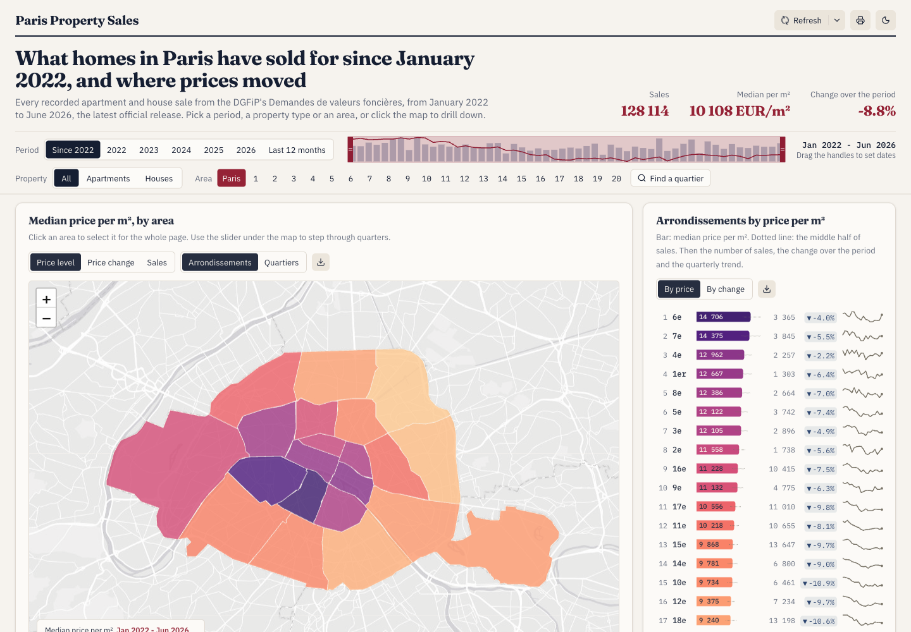
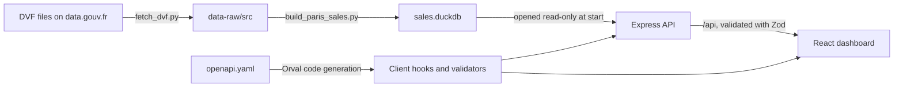

# Paris Property Sales

An interactive dashboard of private home sales in Paris. It is built from DVF (Demandes de valeurs foncières), the open data on property sales published by the French tax administration (DGFiP).



## What it shows

- A map of median price per m² and price change, by arrondissement or quartier, with a slider that steps through quarters.
- A dot map of individual sales.
- A price trend over time, by month, quarter or year, with the middle half of prices shaded.
- A heat map of price per m² for every area and quarter.
- A ranking of arrondissements by price or by change over the period.
- Distributions of sale price and price per m², and prices by number of rooms.
- A sortable list of individual sales, and CSV downloads for each chart.
- Filters for period, property type and area. The filters are stored in the URL, so a link reproduces the view. There is also a dark theme.

## Quick start

You need [Docker](https://docs.docker.com/get-docker/), Python 3 and [uv](https://docs.astral.sh/uv/). The app needs no database server, login or API key.

**1. Get the data.** The sales data is not in this repository (see [Data and licences](#data-and-licences)). This command downloads it from data.gouv.fr and builds the dataset. `uv` installs the `duckdb` package on the first run. The download is about 610 MB, because the source file covers all of France, but only the Paris rows are saved.

```sh
uv run scripts/update_data.py
```

**2. Start the app.**

```sh
docker compose up --build -d
```

Open <http://localhost:3000>. To stop the app, run `docker compose down`.

The container serves the dashboard at `/` and the API at `/api`. It works on x64 and ARM64 machines, including Apple Silicon. The health check is `GET /api/healthz`. The image holds no sales data, so Compose mounts `artifacts/api-server/data` into the container. If that folder has no `sales.duckdb`, the container stops at startup.

## Documentation

- [`docs/architecture.md`](docs/architecture.md) explains how the site works, how to deploy it with Coolify, and what remains to do before a public launch.
- [`CONTEXT.md`](CONTEXT.md) defines the terms this project uses, such as Sale, Mutation and Selection.
- [`docs/adr/`](docs/adr/) records the major decisions and the reasons for them.

## How it works



The API server opens the DuckDB file read-only when it starts, and it calculates every response with SQL queries on that file. The file is the only database, and the server never writes to it. Responses are cached in memory, because the data does not change while the server runs.

| Path | Contents |
| --- | --- |
| `artifacts/data-app` | The React dashboard (Vite, Tailwind, Recharts, Leaflet) |
| `artifacts/api-server` | The Express API |
| `artifacts/api-server/data` | The built sales dataset (`sales.duckdb`, not in git) |
| `artifacts/api-server/boundaries` | Boundary files for the map |
| `lib/api-spec` | The API contract (`openapi.yaml`) and the code generation config |
| `lib/api-client-react`, `lib/api-zod` | The React Query hooks and Zod validators generated from the contract |
| `scripts/update_data.py` | Runs `fetch_dvf.py` and then `build_paris_sales.py`. This is the command to use |
| `scripts/fetch_dvf.py` | Downloads the raw DVF files into `data-raw/src` (not in git) |
| `scripts/build_paris_sales.py` | Builds `sales.duckdb` in `artifacts/api-server/data`, and the files in `artifacts/api-server/boundaries`, from `data-raw` |
| `data-raw` | Raw boundary files, and the downloaded DVF files in `src/` |

`lib/db` and `scripts/src/hello.ts` are unused template code from the original project.

## Run without Docker

You need Node.js 24 and pnpm 10 (`npm install -g pnpm@10`). Get the data first, as described in the quick start.

```sh
pnpm install --frozen-lockfile
BASE_PATH=/ PORT=3000 pnpm --filter @workspace/data-app run build
NODE_ENV=production pnpm --filter @workspace/api-server run build

# Run from artifacts/api-server, so that the server finds the data folder next to dist.
cd artifacts/api-server
NODE_ENV=production PORT=3000 STATIC_DIR=../data-app/dist/public node dist/index.mjs
```

Open <http://localhost:3000>.

The Vite development server has no proxy for `/api`, so `pnpm --filter @workspace/data-app run dev` shows the dashboard without data unless you put a proxy in front of it.

To check the types, run `pnpm run typecheck` at the repository root. To run the tests, run `pnpm run test`.

### Host the dashboard and the API separately

Build the dashboard and serve `artifacts/data-app/dist/public` from any static host. The host must rewrite every unknown path to `/index.html`. The dashboard calls the API at the relative path `/api/...`, so route `/api` on the same domain to the API server, and start that server without `STATIC_DIR`. If the dashboard lives under a sub-path, set `BASE_PATH` (for example `/paris/`) at build time.

## Configuration

| Variable | Used by | Meaning |
| --- | --- | --- |
| `PORT` | API server | The port to listen on. This variable is required. |
| `STATIC_DIR` | API server | The folder with the built dashboard. If it is not set, the server provides only the API. |
| `NODE_ENV` | API server | Use `production`. |
| `LOG_LEVEL` | API server | Optional. The default is `info`. |
| `BASE_PATH` | Dashboard build | The URL prefix of the dashboard. This variable is required at build time. |

## Things to know

- **Startup:** the server pre-computes about 2,800 common responses when it starts, which takes about 22 seconds. The API answers during that time, but the first requests can be slower.
- **Memory:** the container used about 250 to 440 MiB after the warm-up finished, measured twice with Docker. Under load it needs much more. In a test of 120 requests, three quarters of them `/sales/points` for the whole city with different `from` dates, sent 10, 20 and 40 at a time, a container limited to 1 GB was killed for lack of memory in all three runs. With no limit and 40 requests at a time, the peak was 2.2 GiB, against 1.13 GiB for the server before DuckDB. Each setting ran once, with Docker on Apple Silicon. Give the container at least 3 GB.
- **External services:** the browser loads fonts from Google Fonts and map tiles from Esri, so it needs internet access to both. To self-host the fonts, replace the `@import url(...)` line at the top of `artifacts/data-app/src/index.css`. To use another map provider, replace the tile URL in `artifacts/data-app/src/components/sales-map.tsx`. Check Esri's terms of use for your level of traffic.
- **Coverage:** the data covers the latest DVF release, and the dashboard shows its first and last dates. Prices are nominal euros, not adjusted for inflation.
- **Which sales are included:** a sale in the dataset is one DVF "Vente" transaction with exactly one apartment or house and no commercial premises. It costs 20,000 to 20,000,000 EUR, has 9 to 300 m² of built surface, and has a price of 2,000 to 35,000 EUR/m². These rules leave out some residential transactions, and the data note in the app shows how many.

## Update the data

DGFiP publishes a new DVF release each April and October. After each release, update the data by hand. No scheduled job does it.

1. Run `uv run scripts/update_data.py`. The script finds the latest five-year file on data.gouv.fr, downloads it, and rebuilds `sales.duckdb` in full. The dashboard takes every date from the new file, so no text needs an edit.
2. Load the new file. On a local machine, run `docker compose restart`. On the VPS, copy the file with the `rsync` command in [`docs/architecture.md`](docs/architecture.md#update-the-data), and then restart the application. The server opens the data file at startup and caches responses in memory, so it must restart to show the new data. The image does not need a rebuild.

Before the build replaces `sales.duckdb`, it checks the new release. The release must have the expected columns. Its Sale count must be within 15% of the previous file. Every Arrondissement and every Quartier must have Sales. Every date must be in ISO format. The end date must not be earlier than the previous end date. If a check fails, the script prints the reason and exits with an error. The previous `sales.duckdb` and the boundary files stay in place.

When a check fails, read the printed reason and compare the new release with the dataset page on data.gouv.fr. The previous file stays in place, so the site keeps working. A release that is correct but fails a check needs a reviewed change to the check in the code. For example, the Sale count limit is `MAX_COUNT_CHANGE` in `scripts/build_paris_sales.py`.

DGFiP can correct past periods in a new release, so the figures can change when you download the data again.

## Change the API

The API contract is `lib/api-spec/openapi.yaml`. After you edit it, run `pnpm --filter @workspace/api-spec run codegen` to regenerate the client hooks and the validators. Do not edit the `generated` folders by hand.

## Data and licences

The code in this repository is under the [MIT licence](LICENSE). The licence does not cover the data.

| Data | Source | Terms |
| --- | --- | --- |
| Property sales | [DVF géolocalisées](https://www.data.gouv.fr/datasets/demandes-de-valeurs-foncieres-geolocalisees/), DGFiP and Etalab, on data.gouv.fr | Licence Ouverte 2.0, with the DVF reuse conditions below |
| Arrondissement and quartier boundaries | Paris Open Data | Check the current terms on Paris Open Data |

**Why the sales data is not in git:** each record links a price to a street address and coordinates. The [DVF page](https://www.data.gouv.fr/datasets/demandes-de-valeurs-foncieres/) says that reuse must not allow indexing by external search engines, and article R112 A-3 of the Livre des procédures fiscales says that use of the files must not allow people to be re-identified indirectly. A public Git repository cannot guarantee the first condition, so each user downloads the data directly from the source.

**The app is not ready for public hosting yet.** It currently allows search engines (`robots.txt`, and the `robots` meta tag in `artifacts/data-app/index.html`), and it shows the street name and the price of each sale. "Before public launch" in [`docs/architecture.md`](docs/architecture.md) lists the work that remains. Read the [DVF conditions](https://www.data.gouv.fr/datasets/demandes-de-valeurs-foncieres/) and check the current terms of each source before commercial use or redistribution.
