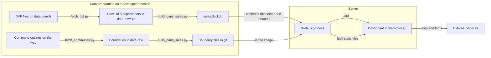
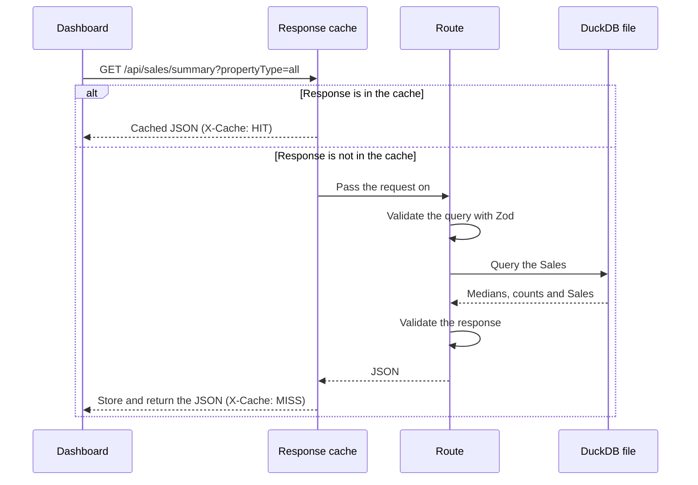

# Architecture

This document explains how the Paris & Suburbs Property Sales site works and how it is deployed. For the meaning of terms such as Sale, Mutation and Selection, see [`CONTEXT.md`](../CONTEXT.md). For the reasons behind major choices, see the [decision records](adr/).

## Overview

The site is one Node.js process. It serves the API and the built dashboard on one port, and it reads all of its data from one DuckDB file. It writes nothing, so it can restart at any time without losing anything.



## Data pipeline

The pipeline has four Python scripts, and it runs outside the application. `uv` runs them and installs the `duckdb` package.

1. `scripts/fetch_dvf.py` finds the latest five-year DVF file on data.gouv.fr by its resource title, streams it, keeps the rows of Paris (75) and of the departments of the Communes (77, 78, 91, 92, 93, 94 and 95), and writes `data-raw/src/dvf.csv` and `data-raw/src/release.txt`. The download is about 610 MB, and the kept file is 478 MB (2,410,074 rows on the October 2026 release).
2. `scripts/build_paris_sales.py` reads `dvf.csv`, `release.txt` and the raw boundary files. It groups rows into Mutations and applies the inclusion rules described in [decision record 4](adr/0004-sale-inclusion-rules.md). It assigns each Sale to a Quartier or to one of the 135 Communes by its code or coordinates. It writes `sales.duckdb`, which records the release month, to `artifacts/api-server/data/`, and the three boundary files to `artifacts/api-server/boundaries/`. Peak memory of the whole update is about 2.7 GB, measured once.
3. `scripts/fetch_communes.py` downloads the Commune outlines (Etalab "Contours administratifs", 2026, 50 m level) into `data-raw/communes.geojson`. `update_data.py` does not call it, because boundaries change far less often than Sales. Run it when the list of Communes in `scripts/communes.py` changes.
4. `scripts/update_data.py` runs the first script and then the second. Both scripts also run alone, so a rebuild does not need another download.

Before the build replaces any file, it checks the new release. The release must have the expected columns. The Sale count must be within 15% of the previous file, counted for Paris and for the Communes separately. Every Arrondissement, every Quartier and every Commune must have Sales. A Commune code in a complete department that is on no list fails the release, because a merger or a rename would otherwise make its Sales vanish. Every date must be in ISO format. No Sale may be dated after the release month. The end date must not be earlier than the previous end date. If a check fails, the script prints the reason, exits with an error, and leaves the previous `sales.duckdb` and the boundary files in place.

| Output file | Contents | In git |
| --- | --- | --- |
| `data/sales.duckdb` | The Sales, the exclusion counts and the release month | No |
| `boundaries/arrondissements.geojson` | The boundaries of the 20 Arrondissements | Yes |
| `boundaries/quartiers.geojson` | The boundaries of the 80 Quartiers | Yes |
| `boundaries/communes.geojson` | The boundaries of the 135 Communes, under the ODbL | Yes |

A new DVF release can change the figures, because the DGFiP can correct past periods.

## API contract

`lib/api-spec/openapi.yaml` defines every endpoint. Orval generates two packages from it.

- `lib/api-zod` holds the Zod validators that the server uses.
- `lib/api-client-react` holds the React Query hooks that the dashboard uses.

A change to the API therefore starts in the YAML file, followed by code generation. The server validates its responses as well as its requests, and Zod removes any field that the contract does not define. See [decision record 3](adr/0003-openapi-contract-first.md).

## Path of a request



- **Sales file:** `salesData.ts` opens `sales.duckdb` when the process starts. `salesDb.ts` opens it read-only and uses one connection for each query. See [decision record 7](adr/0007-duckdb-rebuilt-for-each-release.md).
- **Areas:** a request with no Area means Paris. The Areas are the Arrondissement, the Quartier, the Department (92, 93 or 94) and the Commune.
- **Calculations:** `routes/sales.ts` calls `salesQueries.ts`, which holds all the SQL and calculates each response from the matching Sales. `timeStats.ts` holds the time buckets and the SQL for the Change.
- **Response cache:** `responseCache.ts` keeps responses in memory, up to 256 MB in total, and removes the least recently used first. The key is the path plus the query after validation, with the same schema the route uses. Unknown parameters and different spellings of a value therefore share one entry, and the cache and the route always agree on what a request means. A path that is not listed in `QUERY_SCHEMAS` is not cached.
- **Warm-up:** after the server starts, `prewarm.ts` calls its own API with the URLs the dashboard most often requests. `warmUrls()` produces 4,463 URLs. The time it takes is not yet measured on the new data (TIME_TO_BE_MEASURED_IN_TASK_11). The API answers during this time, but the first requests can be slower. These URLs copy the parameters that the dashboard sends, so a change to those parameters also needs a change in `prewarm.ts`.

## Dashboard

The dashboard is a React application with one page.

- `pages/dashboard.tsx` owns the view and passes the Selection to each panel.
- `lib/view-state.ts` mirrors the view into the URL, so a link reproduces it.
- Each panel in `components/` loads its own data through the generated hooks. React Query keeps responses for 5 minutes without fetching them again.
- Charts use Recharts, and the map uses Leaflet.
- The browser currently loads fonts from Google Fonts and map tiles from Esri.

The Vite development server has no proxy for `/api`, so the dashboard shows no data under `vite dev` until a proxy is added.

## Deployment

The site runs on [Coolify](https://coolify.io) on a VPS in the EU. Coolify builds the image from this public repository. The image holds no sales data, so the data lives in a folder on the VPS and is mounted into the container. See [decision record 1](adr/0001-sales-data-outside-git-and-image.md).

These steps have not yet run on a real Coolify server. A local test covered the same sequence: build from a fresh clone with no data, then mount the data from a separate folder.

### First deployment

1. On your machine, build the data as the [README quick start](../README.md#quick-start) explains.
2. Copy the data folder to the VPS. This must happen before the first deployment, because the image has no data folder and the process stops at startup if `sales.duckdb` is missing.

   ```sh
   rsync -av --delete artifacts/api-server/data/ user@your-vps:/srv/paris-property-sales/data/
   ```

3. In Coolify, create an application from the public repository `https://github.com/palsagar/paris-property-sales`.
4. Set **Build pack** to **Dockerfile**, and set **Ports Exposes** to `3000`.
5. Under **Configuration**, **Persistent Storage**, add a **Directory Mount** from `/srv/paris-property-sales/data` to `/app/data`.
6. Add the domain. Coolify's proxy handles HTTPS.
7. Leave the health check in the Coolify dashboard turned off. It needs `curl` or `wget` in the image, and this image has neither. The Dockerfile has its own health check, which calls `/api/healthz` through Node.
8. Give the application at least 3 GB of memory. The container used about 250 to 440 MiB after the warm-up finished, measured twice with Docker. Under load it needs much more. In a test of 120 requests, three quarters of them `/sales/points` for the whole city with different `from` dates, sent 10, 20 and 40 at a time, a container limited to 1 GB was killed for lack of memory in all three runs. With no limit and 40 requests at a time, the peak was 2.2 GiB, against 1.13 GiB for the server before DuckDB. Each setting ran once, with Docker on Apple Silicon.

The image sets `PORT`, `STATIC_DIR` and `NODE_ENV`, so the application needs no environment variables in Coolify.

### Update the data

DGFiP publishes a DVF release each April and October. After each release:

1. Run `uv run scripts/update_data.py` on your machine, as the [README](../README.md#update-the-data) explains.
2. Run the `rsync` command in "First deployment" above.
3. Restart the application in Coolify. The image does not need a rebuild.

If a release needs a new image as well, copy the new file before the new image starts. The server stops at startup when the file has no release month.

Coolify's storage is not a backup, but the data does not need one. The scripts can rebuild it from the source for as long as DVF publishes those periods.

## Before public launch

The site is not ready for the public yet. These items must be complete first.

- **Block search engines.** Change `robots.txt` and the `robots` meta tag, and block `/api` as well. Both currently allow indexing.
- **Make the API private to the site.** Remove the open CORS setting, add rate limits, cap the number of records in one response, and limit exports to what is on screen. The rate limits need Express to trust Coolify's proxy, so that they see each Visitor's real IP address. Until then, many requests for valid but different large responses can push warmed entries out of the cache, which makes later requests slower but does not make them wrong. Many such requests at once can also stop the server, because each one holds its whole result in memory until it finishes. The 5,000 Sale cap in issue #5 reduces this risk, and the rate limits must bound it. Rerun the burst test after issue #5 and before launch, because the Sales have tripled. Do not make the site public between #4 and #5.
- **Publish a legal notice and a privacy notice.** The privacy notice must cover any outside service that the browser still contacts.
- **Self-host the fonts and replace the Esri tiles.** We could not confirm that Esri's tile address can be used on a public site without an account. Choose a map provider with terms that clearly allow public use.
- **Accept the re-identification risk knowingly.** No Sale holds its `id_mutation` any more, so a Visitor cannot join a Sale to the public DVF file by that identifier. Date, price, surface and street together still identify 404,405 of the 404,582 Sales uniquely. We accept this risk, and the DGFiP condition against indirect re-identification is not fully met. [Decision record 6](adr/0006-public-site-limits.md) records it.
- **Design the map for rounded Sale locations.** Several dots stack on one position. Several Sales share one position, and the stacks are larger now that the Communes are included.

[Decision record 6](adr/0006-public-site-limits.md) explains the location, search engine and API limits.

## Improvements

These items do not block launch.

- French by default, with an English option.
- A clear statement that the site gives no Valuation, and warnings for small samples.
- Copy fixes: "Carrez or built surface" on the surface card, and "transactions" in the sales list.
- A warning for a Change over a Period of less than 12 months.
- A proxy for `/api` in the Vite development server.
- Removal of the unused template code: `lib/db`, `scripts/src/hello.ts`, the Replit dependencies and the unused UI components.

## Planned work

This document describes the site as it is today. Only one item remains before the public launch.

1. [Make every Selection change draw within 200 ms](https://github.com/palsagar/paris-property-sales/issues/5).
