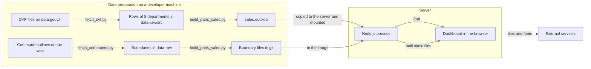
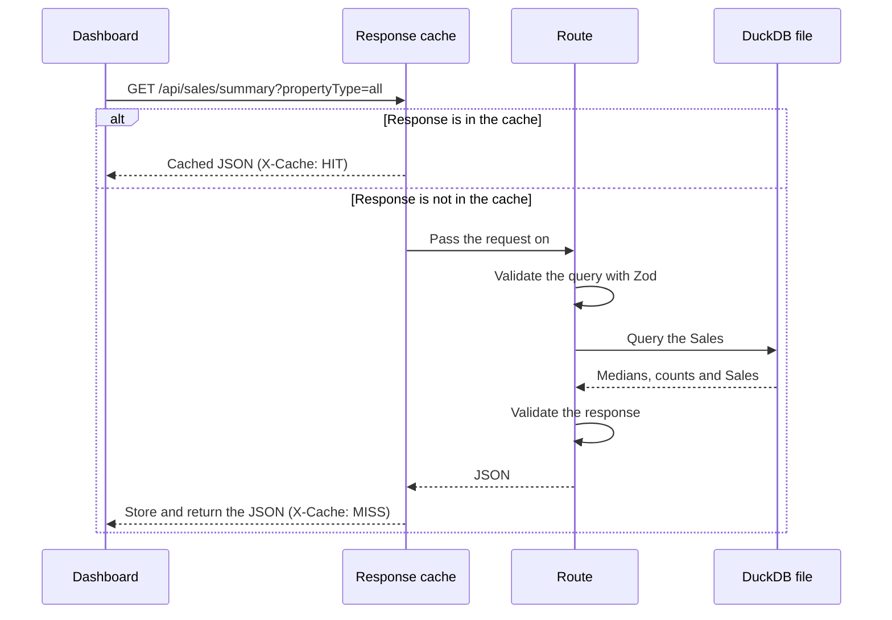

# Architecture

This document explains how the Paris & Suburbs Property Sales site works and how it is deployed. For the meaning of terms such as Sale, Mutation and Selection, see [`CONTEXT.md`](../CONTEXT.md). For the reasons behind major choices, see the [decision records](adr/).

## Overview

The site is one Node.js process. It serves the API and the built dashboard on one port, and it reads all of its data from one DuckDB file. It writes nothing, so it can restart at any time without losing anything.



## Data pipeline

The pipeline has four Python scripts, and it runs outside the application. `uv` runs them and installs the `duckdb` package.

1. `scripts/fetch_dvf.py` finds the latest five-year DVF file on data.gouv.fr by its resource title, streams it, keeps the rows of Paris (75) and of the departments of the Communes (77, 78, 91, 92, 93, 94 and 95), and writes `data-raw/src/dvf.csv` and `data-raw/src/release.txt`. The download is about 610 MB, and the kept file is 478 MB (2,410,074 rows on the October 2026 release).
2. `scripts/build_paris_sales.py` reads `dvf.csv`, `release.txt` and the raw boundary files. It groups rows into Mutations and applies the inclusion rules described in [decision record 4](adr/0004-sale-inclusion-rules.md). It assigns each Sale to a Quartier or to one of the 135 Communes by its code or coordinates. It writes `sales.duckdb`, which records the release month, to `artifacts/api-server/data/`, and the three boundary files to `artifacts/api-server/boundaries/`. Peak memory of the whole update is about 2.7 GB, measured once.
3. `scripts/fetch_communes.py` downloads the Commune outlines (Etalab "Contours administratifs", 2026, 50 m level) into `data-raw/communes.geojson`. `update_data.py` does not call it, because boundaries change far less often than Sales. Run it when the list of Communes in `scripts/communes.py` changes.
4. `scripts/update_data.py` runs the first script and then the second. Both scripts also run alone, so a rebuild does not need another download.

Before the build replaces any file, it checks the new release. The release must have the expected columns. The Sale count must be within 15% of the previous file, counted for Paris and for the Communes separately. Every Arrondissement, every Quartier and every Commune must have Sales. A Commune code in a complete department that is on no list fails the release, because a merger or a rename would otherwise make its Sales vanish. Every date must be in ISO format. No Sale may be dated after the release month. The end date must not be earlier than the previous end date. If a check fails, the script prints the reason, exits with an error, and leaves the previous `sales.duckdb` and the boundary files in place.

| Output file | Contents | In git |
| --- | --- | --- |
| `data/sales.duckdb` | The Sales, the exclusion counts and the release month | No |
| `boundaries/arrondissements.geojson` | The boundaries of the 20 Arrondissements | Yes |
| `boundaries/quartiers.geojson` | The boundaries of the 80 Quartiers | Yes |
| `boundaries/communes.geojson` | The boundaries of the 135 Communes, under the ODbL | Yes |

A new DVF release can change the figures, because the DGFiP can correct past periods.

## API contract

`lib/api-spec/openapi.yaml` defines every endpoint. Orval generates two packages from it.

- `lib/api-zod` holds the Zod validators that the server uses.
- `lib/api-client-react` holds the React Query hooks that the dashboard uses.

A change to the API therefore starts in the YAML file, followed by code generation. The server validates its responses as well as its requests, and Zod removes any field that the contract does not define. See [decision record 3](adr/0003-openapi-contract-first.md).

## Path of a request



- **Sales file:** `salesData.ts` opens `sales.duckdb` when the process starts. `salesDb.ts` opens it read-only and uses one connection for each query. See [decision record 7](adr/0007-duckdb-rebuilt-for-each-release.md).
- **Limits:** see "Limits on the API" under "Deployment".
- **Areas:** a request with no Area means Paris. The Areas are the Arrondissement, the Quartier, the Department (92, 93 or 94) and the Commune.
- **Calculations:** `routes/sales.ts` calls `salesQueries.ts`, which holds all the SQL and calculates each response from the matching Sales. `timeStats.ts` holds the time buckets and the SQL for the Change.
- **Response cache:** `responseCache.ts` keeps responses in memory, up to 256 MB in total, and removes the least recently used first. The key is the path plus the query after validation, with the same schema the route uses. Unknown parameters and different spellings of a value therefore share one entry, and the cache and the route always agree on what a request means. A path that is not listed in `QUERY_SCHEMAS` is not cached. Express ignores case and one trailing slash when it routes, so the key does too. When identical requests arrive while the first one runs, they wait for it and get its response, so the query runs once. They share an error as well, but an error is never cached.
- **Warm-up:** after the server starts, `prewarm.ts` calls its own API with the URLs the dashboard most often requests. `warmUrls()` in `warmUrls.ts` produces 1,683 URLs: the default view of each Area, which is all dates and all property types. It takes about 15 seconds: 14.5 to 15.4 seconds in three runs with no other traffic, with Docker on Apple Silicon. The API answers during this time, but the first requests can be slower. These URLs copy `selectionQueries()` in the dashboard's `lib/selection-queries.ts`, so a change to the parameters a panel sends also needs a change in `warmUrls.ts`. A test in the dashboard's `lib/selection-queries.test.ts` fails until the two agree. Other Periods and property types are not warmed. Their first request takes 10 to 60 ms on the server.

## Dashboard

The dashboard is a React application with one page.

- `pages/dashboard.tsx` owns the view and passes the Selection to each panel.
- `lib/view-state.ts` mirrors the view into the URL, so a link reproduces it.
- `lib/shown-view.tsx` keeps two views. The requested view drives the filter buttons and the URL at once. The shown view drives every panel and heading. It changes when all the data of the requested view has loaded, so the page changes in one redraw and never shows one Area's figures under another Area's name. It changes after 3 seconds at the latest, so a request that never answers cannot freeze the page, and a panel still loading then shows its loading state. An "Updating" label shows meanwhile.
- `lib/selection-queries.ts` builds the params of every request. The page loads `selectionQueries()` before it shows a new view, and the panels build their params with the same functions, so the two always agree.
- The dot map shows the newest 5,000 located Sales of the Selection at most. It draws one dot per rounded position and Area, moved by a fixed amount inside its 100 m cell so that the dots do not form a grid.
- `e2e/latency.mjs` measures each Selection change at a 2x CPU slowdown and checks the behaviour above. A change takes at most 200 ms of main-thread work from the moment it is asked for, which for the time slider is the release of the handle. The drag's own frames, about 50 to 60 ms, and the map's fly-to on an Area change, about 60 to 110 ms, come on top, and the test reports them apart. Reduced motion turns the fly-to off.
- Each panel in `components/` loads its own data through the generated hooks. React Query keeps responses for 5 minutes without fetching them again.
- Charts use Recharts, and the map uses Leaflet.
- Every visible text is in `lib/i18n/en.ts` and `lib/i18n/fr.ts`. A new text goes into both files. `fr.ts` has the type of `en.ts`, so the type check finds a missing French text, and `messages.test.ts` finds a French text that is still English. The French terms come from `CONTEXT.md`. Area names, street names and "11e arrondissement" stay the same in both languages, and so do numbers and money ("12 000 EUR").
- The page starts in the Visitor's saved language (`localStorage` key `lang`). Without one, it starts in French when the browser's first language is French, and in English otherwise. The language is never in the URL. A change redraws the whole page under a new React key, which resets the map's zoom and any open picker. The Selection is in the URL and the data is in the React Query cache, so nothing is fetched again. The client builds the year and quarter labels from their dates, so the API stays the same in both languages.
- The browser currently loads fonts from Google Fonts and map tiles from Esri.

The Vite development server has no proxy for `/api`, so the dashboard shows no data under `vite dev` until a proxy is added.

## Analytics

The site counts visits and the use of its controls with [Umami](https://umami.is), self-hosted next to the site on Coolify. Umami sets no cookies.

- The server adds the Umami script to `index.html` only when `UMAMI_SCRIPT_URL` and `UMAMI_WEBSITE_ID` are set (`lib/umami.ts` in the API server). Local builds, the tests and forks of the repository therefore send nothing. The script loads with `async`, so a slow Umami server never delays the dashboard, and it honours Do Not Track.
- Each visit counts as one page view, without the query string. The query string holds the Selection, and the events below record it.
- `lib/analytics.ts` in the dashboard lists every event and its properties. Each control's handler calls `track()`, which sends the event on a later task, so it adds no work to the click. An event fires only when the Visitor changes something.

| Event | Properties |
| --- | --- |
| `open` | The Selection and map mode of a link or bookmark. It is sent once, and only when the link carries settings. |
| `select-area` | `level`, `area` (its name), `code` and `via`: buttons, search, map, dot, ranking, heatmap, sales-list or back-link. Back and Forward in the browser send nothing, because they are not a control. |
| `select-property-type`, `change-period` | The new value. A Period is sent as months, with `via` (preset, slider, or months for the From and To menus) and the preset's kind. The slider sends one event at its release. |
| `change-map-mode`, `change-map-level`, `time-travel`, `change-ranking-group`, `sort-ranking`, `change-heatmap-colour`, `change-granularity`, `toggle-smoothing`, `toggle-band`, `sort-sales`, `page-sales` | The new value |
| `change-compare-view` | `view`: map or list (the tabs on a phone), ranking or quarters (the tabs of the areas card) |
| `export-csv` | The panel |
| `copy-link` | `via`: clipboard or share. The link itself is never sent. |
| `print` | None |
| `toggle-dark-mode` | The new value |
| `change-language` | `to`: en or fr |
| `author-link` | `target`: site or github |

An event carries the same values in both languages. For example, `select-area` sends `area: "Paris 11e"` and `open` sends `type: "apartment"` in French too, so the statistics do not split by language. Umami also records the page title. The title follows the language ("Paris & Suburbs Property Sales" or "Ventes immobilières à Paris et alentours"), so the page title report shows both titles.

These are never sent:
- anything about a single Sale, such as its id, street, price or position, because data sent to Umami cannot be taken back (see [decision record 6](adr/0006-public-site-limits.md))
- the text typed in the area search box
- hovers, map zoom and pan, the frames of a drag, and errors

The `analytics` section of `e2e/latency.mjs` replaces Umami with a stub. It checks the event of each control and that no event carries a key outside the agreed list or a number other than a page of the Sales list.

## Deployment

The site runs on [Coolify](https://coolify.io) on a VPS in the EU. Coolify builds the image from this public repository. The image holds no sales data, so the data lives in a folder on the VPS and is mounted into the container. See [decision record 1](adr/0001-sales-data-outside-git-and-image.md).

These steps have not yet run on a real Coolify server. A local test covered the same sequence: build from a fresh clone with no data, then mount the data from a separate folder.

### First deployment

1. On your machine, build the data as the [README quick start](../README.md#quick-start) explains.
2. Copy the data folder to the VPS. This must happen before the first deployment, because the image has no data folder and the process stops at startup if `sales.duckdb` is missing.

   ```sh
   rsync -av --delete artifacts/api-server/data/ user@your-vps:/srv/paris-property-sales/data/
   ```

3. In Coolify, create an application from the public repository `https://github.com/palsagar/paris-property-sales`.
4. Set **Build pack** to **Dockerfile**, and set **Ports Exposes** to `3000`.
5. Under **Configuration**, **Persistent Storage**, add a **Directory Mount** from `/srv/paris-property-sales/data` to `/app/data`.
6. Add the domain. Coolify's proxy handles HTTPS.
7. Leave the health check in the Coolify dashboard turned off. It needs `curl` or `wget` in the image, and this image has neither. The Dockerfile has its own health check, which calls `/api/healthz` through Node.
8. Give the application at least 3 GB of memory. The container used about 315 to 340 MiB after the warm-up finished, measured three times with Docker on the 404,582 Sales. Under load it needs more. In a test of 120 requests that were not in the cache, three quarters of them `/sales/points` for the whole city with different `from` dates and the rest `/sales/summary`, sent 10, 20 and 40 at a time, every request succeeded in every run. A container limited to 1 GB survived all three runs, with a peak of 527 to 543 MiB. With no limit, the peak was 760 to 784 MiB. Before the 5,000 Sale cap on `/sales/points`, the container limited to 1 GB was killed in all three runs. The peaks are the container's `memory.peak`, which includes the file cache. Each setting ran once, with Docker on Apple Silicon.

The image sets `PORT`, `STATIC_DIR`, `NODE_ENV` and `SITE_URL` (`https://parism2.gpuphysics.dev`), so the application needs no environment variables in Coolify. Set `SITE_URL` in Coolify to override the public address. The server uses it for the absolute addresses of the link preview (`lib/pageMeta.ts`). Without a valid `SITE_URL`, link previews have no image, and the server logs a warning.

The container runs Node as the image's `node` user (uid 1000), not as root. That user must be able to read `sales.duckdb` and its folder: mode 644 for the file and 755 for the folder are enough. DuckDB opens the file read-only and writes nothing.

### Limits on the API

In production a request goes from the Visitor to Cloudflare, then to Coolify's proxy (Traefik), then to Node.

- **Visitor address:** Express trusts only proxies on the machine itself or on a private network, which is where Traefik runs (`lib/visitorIp.ts`). `req.ip` is then the address that Traefik received the request from. When that address is in Cloudflare's published ranges, the server takes the Visitor's address from Cloudflare's `CF-Connecting-IP` header. Cloudflare replaces any value the Visitor sends in that header. A request that reaches the server without Cloudflare cannot use the header, because its address is not Cloudflare's. A count of proxy hops would not work here: Traefik by default replaces an `X-Forwarded-For` that comes from outside, so the Visitor's address is lost. If Cloudflare adds ranges, update the list from <https://www.cloudflare.com/ips/>. Until then, Visitors who reach a new range share one limit.
- **Rate limit:** each Visitor address may make 600 API requests a minute (`lib/rateLimit.ts`). One Selection change makes about a dozen requests, so a Visitor would need 50 changes in one minute to reach the limit. Over the limit, the API answers 429 with a `Retry-After` header. Requests from the machine itself or a private network are never limited. This covers the warm-up and the latency test against a local container. The page itself and its files have no limit.
- **Query time limit:** DuckDB stops any query after 5 seconds (`lib/salesDb.ts`), and the API answers 503. Queries usually take 10 to 60 ms. In a test of 40 different `/sales/points` requests at once that were not in the cache, the slowest took 0.8 seconds. A 503 is never cached.
- **Other headers:** every response forbids other sites to show the page in a frame (`Content-Security-Policy: frame-ancestors 'none'` and `X-Frame-Options: DENY`). The API sends no CORS headers, so other sites cannot read its responses in a browser. The server reads no request bodies.

Every response carries `X-Robots-Tag: noindex, nofollow`, and `index.html` has the same `robots` meta tag, so search engines do not index the site. `robots.txt` allows the page and disallows `/api/`, so the apps that draw link previews can read the page.

### Update the data

DGFiP publishes a DVF release each April and October. After each release:

1. Run `uv run scripts/update_data.py` on your machine, as the [README](../README.md#update-the-data) explains.
2. Run the `rsync` command in "First deployment" above.
3. Restart the application in Coolify. The image does not need a rebuild.
4. If the link preview's colours should follow the new release, run `pnpm --filter @workspace/data-app run og-image` against a local server with the new data, commit `artifacts/data-app/public/og-image.png`, and deploy. Apps such as WhatsApp keep a preview they have already shown.

If a release needs a new image as well, copy the new file before the new image starts. The server stops at startup when the file has no release month.

Coolify's storage is not a backup, but the data does not need one. The scripts can rebuild it from the source for as long as DVF publishes those periods.

## Before public launch

The site is not ready for the public yet. These items must be complete first.

- **Make the API private to the site.** Limit exports to what is on screen. The rest is done: the open CORS setting is gone, Express trusts Coolify's proxy and Cloudflare, each Visitor has a rate limit, each query has a time limit, `/sales/points` returns at most 5,000 Sales, and a page of `/sales/transactions` at most 200. See "Limits on the API" above. Check after the first deployment that the server logs real Visitor addresses and not Cloudflare's.
- **Publish a legal notice and a privacy notice.** The privacy notice must cover any outside service that the browser still contacts. It must name Umami, say that it sets no cookies and records no data about a single Sale, and say that the site honours Do Not Track.
- **Self-host the fonts and replace the Esri tiles.** We could not confirm that Esri's tile address can be used on a public site without an account. Choose a map provider with terms that clearly allow public use.
- **Accept the re-identification risk knowingly.** No Sale holds its `id_mutation` any more, so a Visitor cannot join a Sale to the public DVF file by that identifier. Date, price, surface and street together still identify 404,405 of the 404,582 Sales uniquely. We accept this risk, and the DGFiP condition against indirect re-identification is not fully met. [Decision record 6](adr/0006-public-site-limits.md) records it.

[Decision record 6](adr/0006-public-site-limits.md) explains the location, search engine and API limits.

## Improvements

These items do not block launch.

- A clear statement that the site gives no Valuation, and warnings for small samples.
- Copy fixes: "Carrez or built surface" on the surface card, and "transactions" in the sales list.
- A warning for a Change over a Period of less than 12 months.
- A proxy for `/api` in the Vite development server.
- Removal of the unused template code: `lib/db`, `scripts/src/hello.ts`, the Replit dependencies and the unused UI components.
