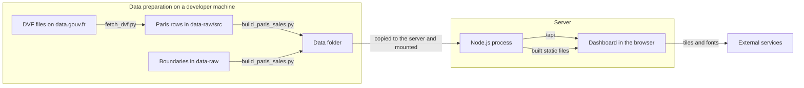
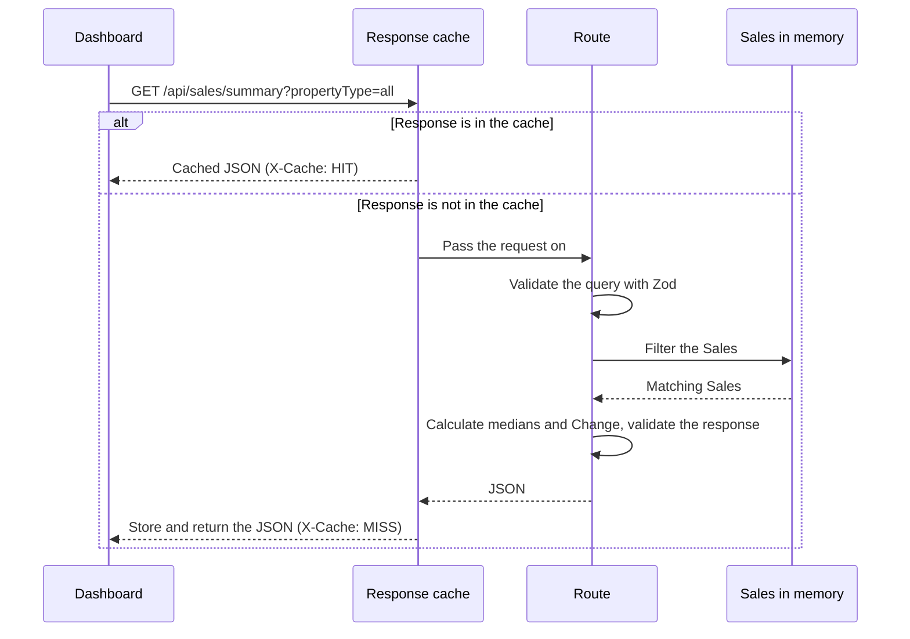

# Architecture

This document explains how the Paris Property Sales site works and how it is deployed. For the meaning of terms such as Sale, Mutation and Selection, see [`CONTEXT.md`](../CONTEXT.md). For the reasons behind major choices, see the [decision records](adr/).

## Overview

The site is one Node.js process. It serves the API and the built dashboard on one port, and it holds all of its data in memory. It writes nothing, so it can restart at any time without losing anything.



## Data pipeline

The pipeline has two standard-library Python scripts, and it runs outside the application.

1. `scripts/fetch_dvf.py` streams the national DVF files for each period, keeps the rows for department 75, and writes `data-raw/src/paris-*.csv`. The download is about 500 MB, and the saved rows are about 74 MB.
2. `scripts/build_paris_sales.py` reads every `paris-*.csv` file and the raw boundary files. It groups rows into Mutations and applies the inclusion rules described in [decision record 4](adr/0004-sale-inclusion-rules.md). It also assigns each Sale to a Quartier by its coordinates. It writes three files to `artifacts/api-server/data/`.

| Output file | Contents | In git |
| --- | --- | --- |
| `paris-sales.json` | 128,114 Sales and the exclusion counts (about 26 MB) | No |
| `arrondissements.geojson` | The boundaries of the 20 Arrondissements | Yes |
| `quartiers.geojson` | The boundaries of the 80 Quartiers | Yes |

The November 2026 download reproduces the original dataset byte for byte. A later DVF release can change the figures, because the DGFiP can correct past periods.

## API contract

`lib/api-spec/openapi.yaml` defines every endpoint. Orval generates two packages from it.

- `lib/api-zod` holds the Zod validators that the server uses.
- `lib/api-client-react` holds the React Query hooks that the dashboard uses.

A change to the API therefore starts in the YAML file, followed by code generation. The server validates its responses as well as its requests, and Zod removes any field that the contract does not define. See [decision record 3](adr/0003-openapi-contract-first.md).

## Path of a request



- **In-memory data:** `salesData.ts` loads the dataset when the process starts and indexes the Sales by Arrondissement and Quartier. There is no database. See [decision record 2](adr/0002-in-memory-data-no-database.md).
- **Calculations:** `routes/sales.ts` calculates each response from the filtered Sales. `timeStats.ts` holds the time buckets, the Smoothing window and the Change calculation.
- **Response cache:** `responseCache.ts` keeps responses in memory, up to 256 MB in total, and removes the least recently used first. The key is the path plus the query after validation, with the same schema the route uses. Unknown parameters and different spellings of a value therefore share one entry, and the cache and the route always agree on what a request means. A path that is not listed in `QUERY_SCHEMAS` is not cached.
- **Warm-up:** after the server starts, `prewarm.ts` calls its own API with the URLs the dashboard most often requests. In testing, it stored 2,610 responses in about 17 seconds. The API answers during this time, but the first requests can be slower. These URLs copy the parameters that the dashboard sends, so a change to those parameters also needs a change in `prewarm.ts`.

## Dashboard

The dashboard is a React application with one page.

- `pages/dashboard.tsx` owns the view and passes the Selection to each panel.
- `lib/view-state.ts` mirrors the view into the URL, so a link reproduces it.
- Each panel in `components/` loads its own data through the generated hooks. React Query keeps responses for 5 minutes without fetching them again.
- Charts use Recharts, and the map uses Leaflet.
- The browser currently loads fonts from Google Fonts and map tiles from Esri.

The Vite development server has no proxy for `/api`, so the dashboard shows no data under `vite dev` until a proxy is added.

## Deployment

The site runs on [Coolify](https://coolify.io) on a VPS in the EU. Coolify builds the image from this public repository. The image holds no sales data, so the data lives in a folder on the VPS and is mounted into the container. See [decision record 1](adr/0001-sales-data-outside-git-and-image.md).

These steps have not yet run on a real Coolify server. A local test covered the same sequence: build from a fresh clone with no data, then mount the data from a separate folder.

### First deployment

1. On your machine, build the data as the [README quick start](../README.md#quick-start) explains.
2. Copy the data folder to the VPS. This must happen before the first deployment, because the mount replaces the image's data folder and the process stops at startup if `paris-sales.json` is missing.

   ```sh
   rsync -av --delete artifacts/api-server/data/ user@your-vps:/srv/paris-property-sales/data/
   ```

3. In Coolify, create an application from the public repository `https://github.com/palsagar/paris-property-sales`.
4. Set **Build pack** to **Dockerfile**, and set **Ports Exposes** to `3000`.
5. Under **Configuration**, **Persistent Storage**, add a **Directory Mount** from `/srv/paris-property-sales/data` to `/app/data`.
6. Add the domain. Coolify's proxy handles HTTPS.
7. Leave the health check in the Coolify dashboard turned off. It needs `curl` or `wget` in the image, and this image has neither. The Dockerfile has its own health check, which calls `/api/healthz` through Node.
8. Give the application at least 1 GB of memory. The server used about 355 MB after startup in testing. In a 1 GB container under sustained requests for large responses, it levelled off at about 750 MB.

The image sets `PORT`, `STATIC_DIR` and `NODE_ENV`, so the application needs no environment variables in Coolify.

### Update the data

DVF is published as a series of releases. After each DVF release:

1. Follow "Update the data" in the [README](../README.md#update-the-data) on your machine.
2. Run the `rsync` command above.
3. Restart the application in Coolify. The image does not need a rebuild.

Coolify's storage is not a backup, but the data does not need one. The two scripts can rebuild it from the source for as long as DVF publishes those periods.

## Before public launch

The site is not ready for the public yet. These items must be complete first.

- **Show Sale locations only.** Change `build_paris_sales.py` to drop the house number and round coordinates to about 100 m, so the dataset never contains them. Rounded dots can stack on the map, which the map design must handle.
- **Block search engines.** Change `robots.txt` and the `robots` meta tag, and block `/api` as well. Both currently allow indexing.
- **Make the API private to the site.** Remove the open CORS setting, add rate limits, cap the number of records in one response, and limit exports to what is on screen. The rate limits need Express to trust Coolify's proxy, so that they see each Visitor's real IP address. Until then, many requests for valid but different large responses can push warmed entries out of the cache, which makes later requests slower but does not make them wrong.
- **Publish a legal notice and a privacy notice.** The privacy notice must cover any outside service that the browser still contacts.
- **Self-host the fonts and replace the Esri tiles.** We could not confirm that Esri's tile address can be used on a public site without an account. Choose a map provider with terms that clearly allow public use.

[Decision record 6](adr/0006-public-site-limits.md) explains the location, search engine and API limits.

## Improvements

These items do not block launch.

- French by default, with an English option.
- A clear statement that the site gives no Valuation, and warnings for small samples.
- Copy fixes: "Every recorded" in the introduction, "of this selection" in the data note, "Carrez or built surface" on the surface card, and "transactions" in the sales list.
- A warning for a Change over a Period of less than 12 months.
- Removal of the hardcoded dates, so that a new DVF release needs fewer manual edits.
- A proxy for `/api` in the Vite development server.
- Removal of the unused template code: `lib/db`, `scripts/src/hello.ts`, the Replit dependencies and the unused UI components.

## Planned work

This document describes the site as it is today. The next iteration moves the data to DuckDB and adds the Communes around Paris. It has four parts, in this order, and the public launch follows them.

1. [Move the sales data to DuckDB, with the same figures for Paris](https://github.com/palsagar/paris-property-sales/issues/2). See [decision record 7](adr/0007-duckdb-rebuilt-for-each-release.md).
2. [Take all dates from the data, and check each DVF update](https://github.com/palsagar/paris-property-sales/issues/3).
3. [Add the Communes around Paris and the Major towns](https://github.com/palsagar/paris-property-sales/issues/4).
4. [Make every Selection change draw within 200 ms](https://github.com/palsagar/paris-property-sales/issues/5).
